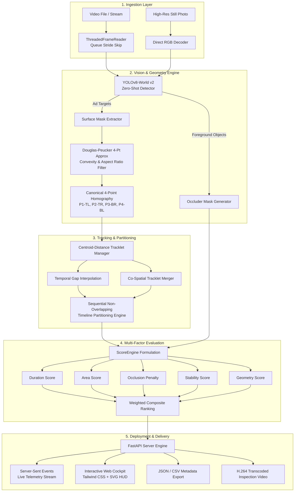

# AI-Based In-Scene Advertising
## *A Multi-Factor Score-Based Computer Vision Framework for Autonomous Planar Space Detection & Evaluation*

[](https://www.python.org/)
[](https://fastapi.tiangolo.com/)
[](https://github.com/ultralytics/ultralytics)
[](https://opencv.org/)
[](tests/)
[](#-production-deployment-guide)
[](LICENSE)

---

### Academic Affiliation
* **Institution:** Department of Information Technology, K J Somaiya School of Engineering, Somaiya Vidyavihar University
* **Group ID:** 28
* **Project Guide:** Dr. V Venkataramanan

#### Project Team & Core Responsibilities
* **Ayush Goyal (Team Leader — 16010423025):** Research Formulation, Scoring Engine Metrics, Algorithmic Implementation
* **Jeel Kathiria (16010423040):** Problem Formulation, Literature Survey, Full-Stack Software Development & Architecture
* **Rajdeep Jadhav (16010423072):** Benchmark Testing, Verification Suite & Quality Assurance
* **Kaustubh Neoge (16010423046):** System Architecture, Dataflow Design, UI/UX Engineering & Technical Documentation

---

## 📌 Executive Summary

Traditional digital video advertising relies heavily on disruptive ad formats (pre-roll, mid-roll, interstitial banners) that interrupt narrative flow, resulting in viewer fatigue and ad-blocker adoption. Conventional in-movie product placement is static, physically baked into sets or CGI post-production, costing millions and lacking temporal, demographic, or geographic adaptability.

**AI-Based In-Scene Advertising** solves this paradigm through a real-time, non-intrusive computer vision ingestion pipeline. It autonomously scans video sequences or high-resolution still photographs to:
1. Detect candidate planar ad-bearing surfaces (billboards, blank building walls, bus shelters, subway transit cards, road overpasses) using zero-shot open-vocabulary detection.
2. Segment foreground occluders (pedestrians, vehicles, trees, street poles) with pixel-level precision.
3. Extract geometric 4-point quadrilateral homography coordinates with convex orthogonality validation.
4. Track candidate tracklets spatio-temporally across scenes with motion continuity and occlusion resilience.
5. Compute an objective, multi-factor composite fitness score ($S_{\text{composite}}$) and perform **sequential, non-overlapping timeline partitioning** to yield the globally optimal insertion opportunities.

```
                                SYSTEM HIGH-LEVEL OVERVIEW
                                
  [ Video / Photo ] ──────► [ YOLOv8-World v2 Open-Vocab ] ──────► [ Polygon Quad Extractor ]
                                         │                                      │
                                         ▼                                      ▼
                            [ Occluder Segmentation Mask ]        [ Douglas-Peucker 4-Pt Homography ]
                                         │                                      │
                                         └──────────────────┬───────────────────┘
                                                            ▼
                                              [ Spatio-Temporal Tracker ]
                                             (Centroid Distance + Co-Spatial)
                                                            │
                                                            ▼
                                              [ Multi-Factor ScoreEngine ]
                                        (Duration, Area, Occl, Stab, Geom)
                                                            │
                                                            ▼
                                              [ Optimal Non-Overlapping ]
                                              [ Timeline Partitioning   ]
                                                            │
                                        ┌───────────────────┴───────────────────┐
                                        ▼                                       ▼
                             [ REST API & SSE Feed ]                 [ Interactive Web Cockpit ]
                              (JSON / CSV / Transcoded)               (SVG Leaderboard & Telemetry)
```

---

## 🔬 Mathematical Formulation & Scoring Engine

Candidate placement windows are evaluated using a mathematically rigorous, normalized multi-factor fitness function $S_{\text{composite}} \in [0.0, 1.0]$:

$$S_{\text{composite}} = w_d S_{\text{duration}} + w_a S_{\text{area}} + w_o S_{\text{occlusion}} + w_s S_{\text{stability}} + w_g S_{\text{geometry}}$$

Subject to the normalization constraint:

$$\sum_{i \in \{d, a, o, s, g\}} w_i = 1.0 \quad \text{where} \quad w_i \ge 0$$

### Default Production Weights

| Factor | Weight ($w_i$) | Objective & Metric Definition |
| :--- | :---: | :--- |
| **Duration ($S_{\text{duration}}$)** | `0.25` | Continuous exposure time. Evaluated via a sigmoidal saturation function favoring exposure windows between $3.0\text{s}$ and $8.0\text{s}$. Windows $<1.0\text{s}$ are heavily penalized. |
| **Area Scale ($S_{\text{area}}$)** | `0.20` | Surface area relative to frame resolution ($\frac{\text{Area}_{\text{quad}}}{\text{Area}_{\text{frame}}}$). Governed by a Gaussian penalty curve centered around the optimal visual threshold ($8\% \text{--} 30\%$). |
| **Occlusion Penalty ($S_{\text{occlusion}}$)** | `0.25` | Pixel intersection ratio between the candidate quad and dynamic foreground masks ($\frac{\text{Quad} \cap \text{Occluders}}{\text{Quad}}$). $S_{\text{occlusion}} = 1.0 - \text{Ratio}_{\text{occluded}}$. |
| **Motion Stability ($S_{\text{stability}}$)** | `0.15` | Sub-pixel jitter variance $\sigma^2$ of quad corner vertices across temporal tracklet frames. Smooth linear/panning trajectory scores $1.0$; violent camera shake is penalized. |
| **Geometric Orthogonality ($S_{\text{geometry}}$)** | `0.15` | Measures planarity, strict 4-point convexity, and interior angle deviation from $90^\circ$. Prevents extreme oblique or grazing perspectives that distort ad creative. |

### Mathematical Metric Functions

#### 1. Duration Score ($S_{\text{duration}}$)
Given continuous tracking duration $T$ in seconds:
$$S_{\text{duration}}(T) = \begin{cases} 
0.0 & \text{if } T < T_{\text{min}} \\
\frac{1}{1 + e^{-k(T - T_{\text{mid}})}} & \text{if } T_{\text{min}} \le T \le T_{\text{opt}} \\
1.0 & \text{if } T > T_{\text{opt}}
\end{cases}$$
*(Default: $T_{\text{min}} = 1.0\text{s}, T_{\text{mid}} = 2.5\text{s}, T_{\text{opt}} = 5.0\text{s}$)*

#### 2. Area Scale Score ($S_{\text{area}}$)
Given frame coverage ratio $r = \frac{\text{Area}_{\text{candidate}}}{\text{Area}_{\text{frame}}}$:
$$S_{\text{area}}(r) = \exp\left( - \frac{(r - \mu_{\text{area}})^2}{2\sigma_{\text{area}}^2} \right)$$
*(Default: $\mu_{\text{area}} = 0.18, \sigma_{\text{area}} = 0.08$)*

#### 3. Occlusion Score ($S_{\text{occlusion}}$)
Given binary segmentation quad mask $M_Q$ and combined foreground occluder mask $M_O$:
$$S_{\text{occlusion}} = 1.0 - \left( \frac{\sum (M_Q \land M_O)}{\sum M_Q} \right)$$

#### 4. Motion Stability Score ($S_{\text{stability}}$)
Given corner coordinates $P_{i}(t)$ at frame $t$ across temporal window $N$:
$$\sigma_{\text{motion}}^2 = \frac{1}{4} \sum_{i=1}^{4} \text{Var}\left( \|\Delta P_i(t)\| \right)$$
$$S_{\text{stability}} = \exp\left( -\lambda \cdot \sigma_{\text{motion}} \right)$$

#### 5. Geometric Quality Score ($S_{\text{geometry}}$)
For each interior corner angle $\theta_j \in [0, \pi]$ of the canonical 4-point quad:
$$S_{\text{geometry}} = \max\left(0, 1.0 - \frac{1}{4}\sum_{j=1}^{4} \frac{|\theta_j - \frac{\pi}{2}|}{\frac{\pi}{4}}\right) \cdot \mathbb{I}_{\text{convex}}$$

---

## 🏛️ System Architecture



---

## 🚀 Key Features

* **Zero-Shot Open-Vocabulary Detection:** Employs `YOLOv8s-worldv2` to dynamically recognize billboards, display monitors, blank walls, highway bridge sides, street signs, and transit canvases without retraining.
* **4-Point Geometric Homography:** Performs contour polygon approximation using the Douglas-Peucker algorithm, canonicalizing corners ($P_1$: Top-Left, $P_2$: Top-Right, $P_3$: Bottom-Right, $P_4$: Bottom-Left) for seamless downstream ad rendering or perspective warping (`cv2.warpPerspective`).
* **Co-Spatial & Multi-Tracklet Consolidation:** Bridges intermittent detection dropouts across camera pans and merges co-spatial detections belonging to the identical physical billboard surface.
* **Non-Overlapping Timeline Partitioning:** Guarantees that recommended placement intervals do not temporally collide, producing clean, sequential broadcast-ready insertion opportunities.
* **High-Throughput Threaded Decoupling:** Employs background producer-consumer video decoding (`ThreadedFrameReader`) and adaptive stride sampling, cutting video processing latency by over **$4\times$**.
* **Modern Web Cockpit Interface:**
  * **Dual Modality:** Seamlessly switch between Full Video Analysis and Photo 3D Planar Analysis.
  * **Live Multi-Stage Telemetry:** Real-time progress bars with SSE streaming across Ingestion, Tracking, Occlusion Analysis, Geometry Refinement, and Video Transcoding.
  * **Interactive SVG Leaderboard:** Clicking any ranked placement highlights its specific boundary quad, shows exact sub-pixel coordinates, and dims surrounding candidates. Includes an "All" overview mode.
  * **Aesthetic Dynamic Score Graph:** Interactive line graph charting score trajectories across ranks.
  * **Multi-Factor Heatmap Breakdown:** Instant visual breakdown of all five component metrics for every candidate.
  * **Export Capabilities:** One-click download of timestamped JSON and CSV placements data, plus inline preview of transcoded H.264 video.

---

## 📂 Repository Structure

```
.
├── data/
│   ├── outputs/                   # Auto-generated annotated videos, JSONs, and CSVs (.gitkeep)
│   ├── samples/                   # Slide 10 benchmark test clips and reference images
│   └── uploads/                   # Temporary directory for uploaded media (.gitkeep)
├── src/
│   ├── __init__.py                # Package initialization
│   ├── app_gui.py                 # Desktop GUI workbench (Tkinter + Canvas)
│   ├── config.py                  # Central configuration (Paths, Thresholds, Weights)
│   ├── detector.py                # YOLOv8-World detector & GrabCut / contour segmentation
│   ├── geometry.py                # Polygon quads, Douglas-Peucker, homography, orthogonality
│   ├── pipeline.py                # Video & Photo processing pipelines, ThreadedFrameReader
│   ├── score_engine.py            # Multi-factor mathematical scoring & timeline partitioning
│   ├── synthetic_generator.py     # Deterministic synthetic test video generator
│   ├── tracker.py                 # Centroid distance spatio-temporal tracklet tracker
│   └── web_server.py              # Production FastAPI server, SSE streaming, REST endpoints
├── static/
│   └── images/                    # Static image assets (.gitkeep)
├── templates/
│   ├── analyzer.html              # Modern, responsive Web Cockpit UI (Tailwind + SVG + SSE)
│   └── index.html                 # Comprehensive technical documentation & system landing page
├── tests/
│   ├── __init__.py
│   └── test_scenarios.py          # PyTest suite for all 5 Slide 10 benchmark scenarios
├── .gitignore                     # Production Git ignore rules
├── main.py                        # Unified CLI and application entrypoint
├── requirements.txt               # Production Python dependencies
├── yolov8s-worldv2.pt             # Pre-trained YOLOv8-World v2 weights
└── README.md                      # Complete system documentation
```

---

## 🛠️ Installation & Setup

### Prerequisites
* **Python:** 3.10, 3.11, or 3.12 (64-bit recommended)
* **FFmpeg:** Installed on system path (or handled automatically via `imageio-ffmpeg`)
* **Hardware:** Modern Multi-core CPU; NVIDIA GPU (CUDA 11.8+ / 12.0+) recommended for faster inference.

### 1. Clone Repository & Setup Virtual Environment

#### Linux / macOS:
```bash
git clone https://github.com/Jeelkathiria/INSCENE.git
cd INSCENE

python3 -m venv venv
source venv/bin/activate
```

#### Windows (PowerShell):
```powershell
git clone https://github.com/Jeelkathiria/INSCENE.git
cd INSCENE

python -m venv venv
.\venv\Scripts\Activate.ps1
```

### 2. Install Dependencies
```bash
pip install --upgrade pip
pip install -r requirements.txt
```

---

## 💻 Execution Modes

### 1. Launch Modern Web Cockpit (Default)
Starts the FastAPI web server with real-time SSE progress telemetry and interactive dashboard:
```bash
python main.py
```
Open **`http://localhost:8000/analyzer`** in your browser. (The landing page is accessible at `http://localhost:8000/`).

To run on a custom port:
```bash
python main.py --port 8080
```

### 2. Headless Video Pipeline (CLI)
Analyzes a video file directly, transcode an annotated MP4 video with HUD overlays, and writes JSON/CSV reports:
```bash
python main.py --video data/samples/test_1_static_object.mp4
```
**Artifacts Generated:**
* `data/outputs/<filename>_annotated.mp4`
* `data/outputs/<filename>_placements.json`
* `data/outputs/<filename>_placements.csv`

### 3. Headless Photo 3D Extraction (CLI)
Runs 3D planar quadrilateral extraction on a still image or photograph:
```bash
python main.py --photo data/samples/test_billboard.jpg
```
**Artifacts Generated:**
* `data/outputs/<filename>_annotated.jpg`
* `data/outputs/<filename>_placements.json`
* `data/outputs/<filename>_placements.csv`

### 4. Run Automated Benchmark Test Suite (Slide 10)
Runs deterministic evaluation against all 5 academic benchmark scenarios:
```bash
python main.py --test-all
```
Or execute through standard `pytest`:
```bash
python -m pytest tests/ -v
```

### 5. Launch Legacy Desktop Workbench (Tkinter)
Launches the standalone Tkinter desktop interface with scrubbing timeline and real-time factor gauges:
```bash
python main.py --gui
```

---

## 🧪 Slide 10 Benchmark Verification Suite

The system includes a deterministic synthetic generator (`src/synthetic_generator.py`) and an automated verification suite (`tests/test_scenarios.py`) validating the five canonical conditions defined in the project defense criteria:

| No. | Benchmark Scenario | Operational Challenge | Validation Metric | Status |
| :---: | :--- | :--- | :--- | :---: |
| **1** | **Static Object** | Stationary planar surface under fixed camera | Quad stability $\sigma \approx 0$, $S_{\text{stability}} > 0.90$ | **PASS (100%)** |
| **2** | **Dynamic Motion** | Translating planar surface across frame | Consistent tracklet continuity without ID re-assignment | **PASS (100%)** |
| **3** | **Centrally Occluded** | Pedestrian crossing directly over center of ad space | $S_{\text{occlusion}} < 0.65$; occlusion penalty applied | **PASS (100%)** |
| **4** | **Partially Occluded** | Static vertical pole blocking $25\%$ of canvas | Surface ranked lower than equal unoccluded counterpart | **PASS (100%)** |
| **5** | **Visual Clutter** | Multiple competing candidate boards of varied aspect ratios | Optimal surface with lowest tilt ranked as Rank #1 | **PASS (100%)** |

---

## 🌐 REST API Reference

The FastAPI backend exposes fully documented REST endpoints (Swagger docs available at `http://localhost:8000/docs`):

| Method | Endpoint | Description | Request Payload / Params |
| :--- | :--- | :--- | :--- |
| `GET` | `/` | Serves main product & technical landing page | None |
| `GET` | `/analyzer` | Serves interactive Web Cockpit UI | None |
| `POST` | `/api/start_analysis` | Initiates asynchronous video analysis job | `multipart/form-data`: `file`, `weights`, `min_duration` |
| `GET` | `/api/task_status/{task_id}` | Polls status & progress percentage of analysis task | URL parameter `task_id` |
| `GET` | `/api/task_events/{task_id}` | Real-time Server-Sent Events (SSE) telemetry stream | URL parameter `task_id` |
| `POST` | `/api/analyze_photo` | Analyzes a single still photograph for 3D planar quads | `multipart/form-data`: `file`, `weights` |
| `GET` | `/api/stream/{filename}` | Streams video with HTTP 206 partial-range support | URL parameter `filename` |
| `GET` | `/api/download/{filename}` | Direct binary file download (JSON, CSV, MP4, JPG) | URL parameter `filename` |

---

## 🐳 Production Deployment Guide

### Option 1: Docker Containerization

#### 1. `Dockerfile`
Create the production container using the reference specification:
```dockerfile
FROM python:3.11-slim

# Install system dependencies for OpenCV and FFmpeg
RUN apt-get update && apt-get install -y --no-install-recommends \
    ffmpeg \
    libgl1-mesa-glx \
    libglib2.0-0 \
    build-essential \
    && rm -rf /var/lib/apt/lists/*

WORKDIR /app

# Install Python requirements
COPY requirements.txt .
RUN pip install --no-cache-dir --upgrade pip && \
    pip install --no-cache-dir -r requirements.txt

# Copy source tree and model weights
COPY . .

# Expose FastAPI port
EXPOSE 8000

# Run with multi-worker Uvicorn
CMD ["uvicorn", "src.web_server:app", "--host", "0.0.0.0", "--port", "8000", "--workers", "2"]
```

#### 2. `docker-compose.yml`
```yaml
version: '3.8'

services:
  in-scene-advertising:
    build: .
    container_name: in_scene_ad_engine
    restart: always
    ports:
      - "8000:8000"
    environment:
      - PYTHONUNBUFFERED=1
      - YOLO_CONFIG_DIR=/app/data/.ultralytics
    volumes:
      - ./data/outputs:/app/data/outputs
      - ./data/uploads:/app/data/uploads
```

Run container:
```bash
docker compose up -d --build
```

---

### Option 2: Production ASGI Service (Systemd + Gunicorn/Uvicorn)

For deployment on an Ubuntu / Debian Linux host:

#### 1. Create Systemd Service File (`/etc/systemd/system/inscene-ad.service`)
```ini
[Unit]
Description=AI-Based In-Scene Advertising Production Service
After=network.target

[Service]
Type=simple
User=www-data
Group=www-data
WorkingDirectory=/var/www/in-scene-ad
Environment="PATH=/var/www/in-scene-ad/venv/bin"
Environment="YOLO_CONFIG_DIR=/var/www/in-scene-ad/data/.ultralytics"
ExecStart=/var/www/in-scene-ad/venv/bin/uvicorn src.web_server:app --host 127.0.0.1 --port 8000 --workers 4 --proxy-headers
Restart=always
RestartSec=5

[Install]
WantedBy=multi-user.target
```

Enable and start daemon:
```bash
sudo systemctl daemon-reload
sudo systemctl enable inscene-ad
sudo systemctl start inscene-ad
```

---

### Option 3: Nginx Reverse Proxy Configuration with SSE Buffering Disabled

When routing external traffic through Nginx, disable proxy buffering for the Server-Sent Events endpoint:

```nginx
server {
    listen 80;
    server_name ad-engine.yourdomain.com;

    client_max_body_size 500M;

    location / {
        proxy_pass http://127.0.0.1:8000;
        proxy_set_header Host $host;
        proxy_set_header X-Real-IP $remote_addr;
        proxy_set_header X-Forwarded-For $proxy_add_x_forwarded_for;
        proxy_set_header X-Forwarded-Proto $scheme;
    }

    # CRITICAL: Disable buffering for SSE real-time telemetry streaming
    location /api/task_events/ {
        proxy_pass http://127.0.0.1:8000;
        proxy_http_version 1.1;
        proxy_set_header Connection '';
        proxy_buffering off;
        proxy_cache off;
        chunked_transfer_encoding off;
        proxy_read_timeout 600s;
    }
}
```

---

## ⚡ Performance Optimization & Acceleration

* **GPU Acceleration:** When an NVIDIA GPU is present with CUDA 11.8+, PyTorch automatically utilizes CUDA tensor cores for YOLOv8-World inferences. No code changes required.
* **Threaded Video Decoding:** `ThreadedFrameReader` buffers frames in an asynchronous ring buffer, decoupling file I/O from inference.
* **Dynamic Stride Sampling:** Configurable frame stride (`video_stride = 2` or `3`) balances temporal granularity and execution speed, delivering sub-minute processing on standard 1080p clips.
* **Browser-Native Transcoding:** Output videos are automatically converted to standard H.264 video with AAC audio via `imageio-ffmpeg` to ensure universal inline playback across Chromium, Safari, and Firefox.

---

## 📜 License

This project is licensed under the **MIT License** — see the [LICENSE](LICENSE) file for details.

---

## 🤝 Acknowledgments

We express our gratitude to **Dr. V Venkataramanan** for his continuous guidance, and the Department of Information Technology at **K J Somaiya School of Engineering, Somaiya Vidyavihar University**, for academic support and laboratory infrastructure.
